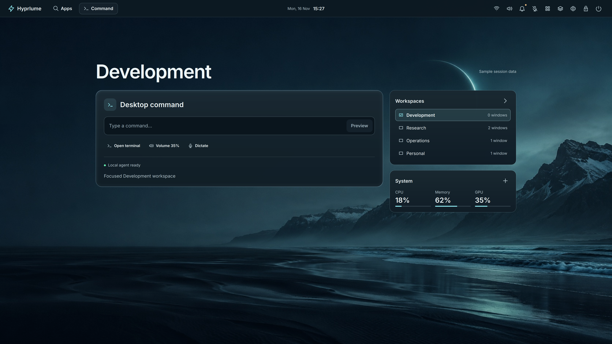
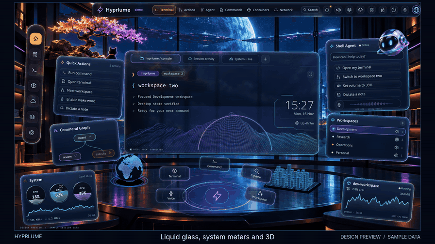

<p align="center"></p>

# Hyprlume

[Project website](https://sumerchoudhary78.github.io/hyprlume/) · [Setup guide](docs/setup.md) · [AUR](https://aur.archlinux.org/packages/hyprlume)

A glass command shell and local English voice companion for **Hyprland**.
Rust handles desktop services, the agent and speech; Quickshell / Qt Quick renders the interface;
[HyprPilot](https://github.com/sumerchoudhary78/HyprPilot) supplies typed desktop control.

**v0.6.0 desktop preview** introduces a reflowing dashboard, clearer command
review and sharper rendering on scaled displays. See
[release validation](docs/validation.md) for the tested environments.

## Desktop preview

The 4K preview shows the new wallpaper, dashboard and compact status bar.
[Shell UI design](docs/design/shell-ui.md)



### v0.5.0 demo



<details>
<summary>Play the 39-second demo</summary>

https://github.com/user-attachments/assets/d1c99a01-4f9b-4a9e-ad00-c62c9d1bb058

</details>

[Download the 39-second demo in 1080p](https://github.com/sumerchoudhary78/hyprlume/releases/download/v0.5.0/hyprlume-v0.5.0-demo.mp4)

The demo was recorded in the Quickshell design preview using sample session data.

## What works

Hyprlume provides the following desktop services.

| Service | Current behavior |
| --- | --- |
| [Notifications](docs/notifications.md) | Popups, actions, bounded history and Do Not Disturb |
| [Audio/media](docs/audio.md) | PipeWire devices, volume/mute, preferred I/O and MPRIS |
| [Power/session](docs/power.md) | Battery, brightness, profiles and confirmed session actions |
| [Idle/sleep](docs/idle-sleep.md) | Opt-in dim/lock/screen-off timers, presentation mode and lock-before-suspend |
| [System tray](docs/tray.md) | StatusNotifier icons, activation and themed DBusMenu menus |
| [Launcher/windows](docs/launcher.md) | XDG app indexing, ranked search and exact-address switching |
| [Clipboard/capture](docs/clipboard-capture.md) | Opt-in text history, screenshots and silent recording |
| [Settings](docs/settings.md) | Live appearance, saved model/startup preferences and shortcut exports |
| [Session locking](docs/locking.md) | Real Wayland/PAM locking, independent supervision and recovery |
| [Polkit](docs/polkit.md) | Opt-in system authorization prompts with the native PAM helper |
| [Desktop portals](docs/portals.md) | Hyprland and GTK routing, app appearance hints and session diagnostics |
| [Input and system keys](docs/input.md) | XKB, mouse and touchpad preferences, persistent shortcuts and glass key feedback |
| [Credential storage](docs/credentials.md) | Secret Service provider, login keyring status and native unlock prompts |
| [Removable drives](docs/storage.md) | Mount, unlock, open and safely remove USB and other removable drives |
| [Desktop preferences](docs/desktop-preferences.md) | Default apps, wallpaper, GTK/Qt, locale, clock and accessibility |
| [Selectable session](docs/session.md) | UWSM-managed login, environment, autostart and service lifecycle |
| [Displays](docs/displays.md) | Modes, scale, arrangement, remembered dock layouts and timed rollback |

Each service page covers setup and verification. The [Hyprlume session](docs/session.md)
appears as its own login option.

- A status bar on each output, a reflowing empty-workspace dashboard and a
  command panel. The dashboard includes workspace switching, command and
  dictation shortcuts, system meters and on-demand telemetry details.
- A glass Connections overlay backed by NetworkManager and BlueZ over D-Bus:
  Wi-Fi scans, saved/open/WPA2/WPA3 connections, radio controls, Bluetooth
  discovery, pairing-code prompts, reconnect/disconnect and forgetting devices.
  See [wireless setup and limits](docs/connectivity.md).
- Direct commands for workspaces, window moves/focus, allowlisted app launches,
  volume, and mute. Direct commands do not need an LLM.
- Streaming English speech recognition, a separate **“Hey Pilot”** wake model,
  explicit dictation mode, and local Piper neural speech output.
- An optional local `llama-server` compatible planner. Model output is parsed
  as a bounded, typed plan; model-generated plans always need confirmation.
- Preview by default, single-use confirmation, bounded IPC, and action receipts.
  Workspace, focus, move, and audio changes are checked against the desktop.

Microphone capture starts **off**. Voice commands preview by default. Dictation
produces selectable text inside the panel; it never becomes a desktop command.
There is no cloud endpoint, transcript database, or screen recording by default.

## Desktop shell

- **Status bar** reserves space on each monitor and provides application
  search, Command, microphone state and desktop controls.
- **Home dashboard** appears on the focused empty workspace. The command card
  uses live daemon state and previews actions. The sidebar shows workspaces,
  window counts, and CPU, memory and GPU usage.
- **Command panel**, an overlay with exclusive keyboard focus, loaded only while
  the daemon reports it open.
- **Connections** opens from the bar’s Wi-Fi button or
  `hyprlume connectivity`. Wireless requests use the connectivity service.

The command card can sample the local wallpaper through a precompiled Qt
Quick shader. Other cards use a solid material. Layout, rendering and
verification commands are in [desktop shell](docs/homescreen.md).
Module layout and import rules are in [shell/README](shell/README.md).

The dashboard runs in a physical Hyprland session and has native rendering,
input and compositor checks. Hardware, scaling and service integration limits
are recorded in [validation](docs/validation.md).

## Install on Arch

```sh
yay -S hyprlume
# or: paru -S hyprlume
```

The AUR recipe builds the Rust application from its release tag. The matching
sherpa-onnx native inference archive is verified with a pinned SHA-256 checksum.
Model weights are downloaded separately, only when you run the model installer.

Start these in **your own Hyprland session**, in separate terminals:

```sh
hyprlume daemon
hyprlume shell
```

Then open the panel or run:

```sh
hyprlume toggle
hyprlume send 'workspace 2'            # preview
hyprlume send 'workspace 2' --execute  # apply a direct command
hyprlume status
hyprlume connectivity                 # open/close Wi-Fi and Bluetooth
hyprlume connectivity --status        # read-only service snapshot
```

`send` returns after the daemon accepts a request. Its result appears in the UI
and `status`. For previews, confirm in the panel or run `hyprlume confirm TOKEN`
using the current `confirmation` value. A token expires after 30 seconds.

For startup services, a launch allowlist, blur, and key bindings, see
[setup](docs/setup.md). Packages do not modify your existing desktop configuration
or enable services automatically.

## Enable local voice

```sh
hyprlume-models                  # ~395 MB download; checksummed upstream bundles
hyprlume doctor                 # read-only prerequisite checks
hyprlume voice wake             # starts microphone capture
hyprlume voice off              # stops capture
```

For spoken feedback, install `espeak-ng`. It supplies pronunciation to the neural
Piper model; its synthetic voice is not used for playback.

Read [voice setup](docs/voice.md) before enabling continuous listening. It covers
mode behavior, configuration, model paths, and the current lack of echo
cancellation/barge-in. You can test speech without opening the microphone:

```sh
hyprlume speak 'Hello from Hyprlume.' --output /tmp/hello.wav
hyprlume transcribe /path/to/english-speech.wav
```

## Build from source

Requires Rust 1.90 or newer. The checked-in lockfile pins the Rust
dependencies and the exact HyprPilot commit. On Linux, install Quickshell,
Qt 6 Quick/Controls/Wayland, Hyprland, PipeWire tools, and
WirePlumber separately. Native wireless builds also need D-Bus development
headers and `pkg-config` (`dbus` and `pkgconf` on Arch). The Polkit worker links
`libpolkit-agent-1` and GLib (`polkit`, `glib2` and `glib2-devel` on Arch).
NetworkManager and BlueZ are optional runtime services. Tested with Quickshell
0.3.2 and Qt 6.12 on Arch.

```sh
git clone https://github.com/sumerchoudhary78/hyprlume.git
cd hyprlume
cargo build --release --locked
cargo test --locked --all-targets
./target/release/hyprlume daemon
# In another terminal, from the same checkout:
./target/release/hyprlume shell --path ./shell
```

Voice support is included by default. sherpa-onnx's build script obtains the
matching native library; it does not download speech weights. To provide that
archive yourself, set `SHERPA_ONNX_ARCHIVE_DIR` as described in
[sherpa-onnx's build documentation](https://docs.rs/sherpa-onnx/2.0.1/sherpa_onnx/#setup).
For a smaller build without native speech, use `--no-default-features`.

For an ordinary window instead of layer-shell surfaces, use
`hyprlume shell --path ./shell --preview`. For a harmless simulated backend,
start `hyprlume daemon --demo` and keep voice off.

## Architecture and performance

```text
Quickshell / QML ← private Unix socket → Rust daemon
                                             ├─ direct command parser
                                             ├─ optional local LLM → review
                                             ├─ validated actions → HyprPilot / PipeWire
                                             ├─ wireless service → NetworkManager / BlueZ
                                             └─ bounded audio worker → wake / ASR / Piper
```

Wallpaper and the bar persist; the dashboard unmaps when an app opens. Metrics
sampling pauses while it is hidden. The clock updates on minute boundaries.
When the command card fits on the dashboard, its glass can sample the local
wallpaper at half resolution. Use `HYPRLUME_REDUCED_EFFECTS=1 hyprlume shell`
for solid surfaces and static battery fill. Wireless state follows D-Bus
events. Bluetooth discovery runs on request and stops after 15 seconds or
panel closure.

The daemon pushes state over one persistent socket. Audio inference runs on a
dedicated worker with a bounded 20 ms frame queue; no inference runs on the UI
thread. Wake spotting uses one CPU thread and ASR/TTS default to two. See [the desktop guide](docs/homescreen.md)
for rendering details, real controls, source layout and asset provenance.

Performance goals and measured limits belong in [validation](docs/validation.md).
UI feedback under 50 ms and idle shell CPU under 1% are targets to verify on
real sessions, not blanket claims about every driver or machine.

## Development

```sh
cargo fmt --all --check
cargo clippy --locked --all-targets -- -D warnings
cargo test --locked --all-targets
python3 scripts/check-qml.py shell
python3 scripts/build-shaders.py --check
python3 scripts/qa/check-effects.py
python3 scripts/qa/render-desktop.py
python3 scripts/qa/render-desktop.py --interact
python3 scripts/qa/render-desktop.py --connectivity --interact
```

Shader binaries are checked in, so source users need no shader compiler at
startup. After editing GLSL, install `qt6-shadertools` and run
`python3 scripts/build-shaders.py`. The AUR build compiles them automatically;
the image-based effects check also requires `python-pillow`.

After opting in to the English model downloads and installing `espeak-ng`:

```sh
cargo test --release --locked --test voice_models -- --ignored --nocapture
```

See [contributing](CONTRIBUTING.md), [architecture](docs/architecture.md), and
[security](SECURITY.md). Application source is **MIT OR Apache-2.0**. Model and
third-party runtime licenses remain separate; see [NOTICE](NOTICE).

The [source map and extension points](docs/architecture.md#source-map) describe
the backend modules. The [shell map](shell/README.md) covers reusable visuals,
derived view state, service interfaces and test fixtures.
