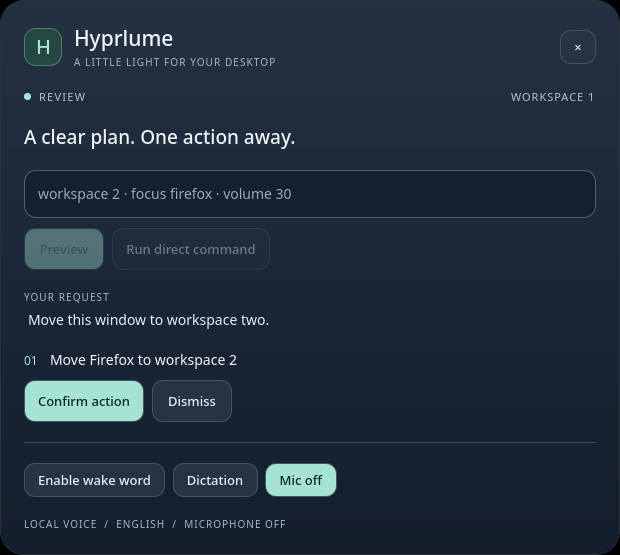

<p align="center"></p>

# Hyprlume

A glass command shell and local English voice companion for **Hyprland**.
Rust handles the agent and audio; Quickshell / Qt Quick renders the interface;
[HyprPilot](https://github.com/sumerchoudhary78/HyprPilot) supplies typed desktop control.

**v0.1.1 is an early preview:** a working command palette, status pill, local
speech pipeline, and foundation for a larger desktop shell. It does not yet
replace an entire desktop environment. See [roadmap](docs/roadmap.md) and
[validation](docs/validation.md) for what is implemented and what remains open.



*Native Qt Quick render with an example action. Compositor background blur is
not present in this offscreen test image.*

## What works

- A compact microphone/status pill and an on-demand glass command panel.
- Direct commands for workspaces, window moves/focus, allowlisted app launches,
  volume, and mute. Direct commands do not need an LLM.
- Streaming English speech recognition, a separate **“Hey Pilot”** wake model,
  explicit dictation mode, and local Piper neural speech output.
- An optional local `llama-server` compatible planner. Model output is parsed
  as a bounded, typed plan; model-generated plans always need confirmation.
- Preview by default, single-use confirmation, bounded IPC, and action receipts.
  Workspace, focus, move, and audio changes are checked against the desktop.

Microphone capture starts **off**. Voice commands preview by default. Dictation
produces selectable text inside the panel; it never becomes a desktop command.
There is no cloud endpoint, transcript database, or screen recording by default.

## Install on Arch

```sh
yay -S hyprlume
# or: paru -S hyprlume
```

The AUR recipe builds the Rust application from its release tag. The matching
sherpa-onnx native inference archive is verified with a pinned SHA-256 checksum.
Model weights are downloaded separately, only when you run the model installer.

Start these in **your own Hyprland session**, in separate terminals:

```sh
hyprlume daemon
hyprlume shell
```

Then open the panel or run:

```sh
hyprlume toggle
hyprlume send 'workspace 2'            # preview
hyprlume send 'workspace 2' --execute  # apply a direct command
hyprlume status
```

`send` returns after the daemon accepts a request. Its result appears in the UI
and `status`. For previews, confirm in the panel or run `hyprlume confirm TOKEN`
using the current `confirmation` value. A token expires after 30 seconds.

For startup services, a launch allowlist, blur, and key bindings, see
[setup](docs/setup.md). Packages do not modify your existing desktop configuration
or enable services automatically.

## Enable local voice

```sh
hyprlume-models                  # ~395 MB download; checksummed upstream bundles
hyprlume doctor                 # read-only prerequisite checks
hyprlume voice wake             # starts microphone capture
hyprlume voice off              # stops capture
```

For spoken feedback, install `espeak-ng`. It supplies pronunciation to the neural
Piper model; its synthetic voice is not used for playback.

Read [voice setup](docs/voice.md) before enabling continuous listening. It covers
mode behavior, configuration, model paths, and the current lack of echo
cancellation/barge-in. You can test speech without opening the microphone:

```sh
hyprlume speak 'Hello from Hyprlume.' --output /tmp/hello.wav
hyprlume transcribe /path/to/english-speech.wav
```

## Build from source

Requires a current Rust toolchain. The checked-in lockfile pins the Rust
dependencies and the exact HyprPilot commit. On Linux, install Quickshell,
Qt 6 Quick/Controls/Wayland, Hyprland, PipeWire tools, and WirePlumber separately.

```sh
git clone https://github.com/sumerchoudhary78/hyprlume.git
cd hyprlume
cargo build --release --locked
cargo test --locked --all-targets
./target/release/hyprlume daemon
# In another terminal, from the same checkout:
./target/release/hyprlume shell --path ./shell
```

Voice support is included by default. sherpa-onnx's build script obtains the
matching native library; it does not download speech weights. To provide that
archive yourself, set `SHERPA_ONNX_ARCHIVE_DIR` as described in
[sherpa-onnx's build documentation](https://docs.rs/sherpa-onnx/2.0.1/sherpa_onnx/#setup).
For a smaller build without native speech, use `--no-default-features`.

For an ordinary window instead of layer-shell surfaces, use
`hyprlume shell --path ./shell --preview`. For a harmless simulated backend,
start `hyprlume daemon --demo` and keep voice off.

## Architecture and performance

```text
Quickshell / QML ← private Unix socket → Rust daemon
                                             ├─ direct command parser
                                             ├─ optional local LLM → review
                                             ├─ validated actions → HyprPilot / PipeWire
                                             └─ bounded audio worker → wake / ASR / Piper
```

The panel exists only while open. Healthy UI connections have no polling timer.
The daemon consumes compositor events and pushes state changes over a persistent
socket. Audio inference runs on a dedicated worker with a bounded queue of
20 ms frames. Keyword spotting uses one CPU thread; ASR/TTS default to two.
There are no shader effects, full-screen blur surfaces, or looping animations.

Performance goals and measured limits belong in [validation](docs/validation.md).
UI feedback under 50 ms and idle shell CPU under 1% are targets to verify on
real sessions, not blanket claims about every driver or machine.

## Development

```sh
cargo fmt --all --check
cargo clippy --locked --all-targets -- -D warnings
cargo test --locked --all-targets
QT_QPA_PLATFORM=offscreen QT_QUICK_BACKEND=software \
  qmltestrunner -input tests/qml
```

After opting in to the English model downloads and installing `espeak-ng`:

```sh
cargo test --release --locked --test voice_models -- --ignored --nocapture
```

See [contributing](CONTRIBUTING.md), [architecture](docs/architecture.md), and
[security](SECURITY.md). Application source is **MIT OR Apache-2.0**. Model and
third-party runtime licenses remain separate; see [NOTICE](NOTICE).
