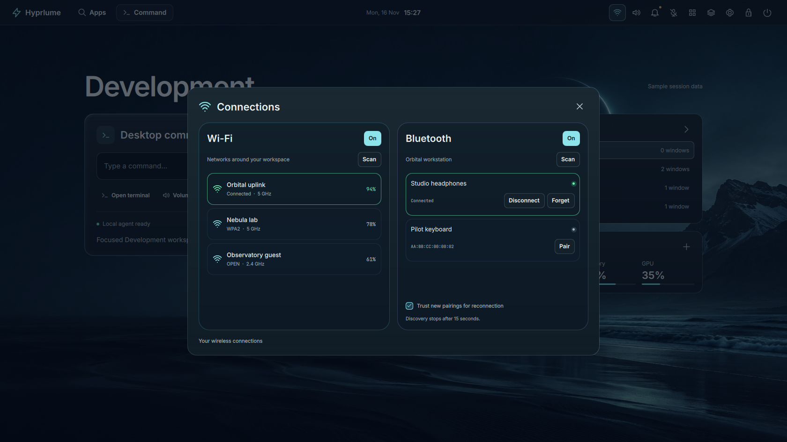

# Wi-Fi and Bluetooth

Open **Quick settings → Connections** or use the CLI.

```sh
hyprlume connectivity
hyprlume connectivity --status
```

The first command toggles Connections. The second only reads a snapshot; it
does not scan, change radios or connect. Escape closes the overlay. Below 730
pixels the two panes become tabs. The panel uses the shell's glass materials,
focus treatment and reduced-effects profile.



*Actual QML render; all network and device records in this image are synthetic.*

## Requirements

Wi-Fi uses NetworkManager; Bluetooth uses BlueZ. Each is optional and its pane
reports unavailable when its service or hardware is absent. On an Arch machine
that already uses NetworkManager, install/enable only the missing service:

```sh
sudo pacman -S networkmanager bluez
sudo systemctl enable --now NetworkManager.service bluetooth.service
```

Do not start NetworkManager alongside another manager controlling the same
interface without migrating that configuration. Hyprlume neither enables
services nor replaces network configuration during installation. Run the
daemon as your graphical-session user, without sudo. System D-Bus and normal
NetworkManager/BlueZ authorization apply. A permission error may require the
session's existing polkit agent; Hyprlume never escalates itself.

## Wi-Fi

Scan, select a network, and connect using its saved profile or enter its
password. New open, WPA2 Personal and WPA3 Personal connections are supported.
Saved profiles can be activated without reading their password into the UI;
the optional **Use a different password** control submits a replacement to
NetworkManager. Disconnect targets the selected network's interface. Forget
requires a second click bound to that profile's UUID.

An existing 802.1X profile can be activated, but creating enterprise profiles
and entering certificate/identity fields are not implemented. New hidden-SSID,
WEP and OWE profiles are not implemented. Only in-range saved profiles appear;
this is not yet a complete saved-connections editor. NetworkManager owns profile
storage, secret persistence and connection activation. Password changes can
therefore update its stored profile.

Snapshots contain up to 32 networks, prioritizing connected networks and signal
strength. Selection binds interface, SSID bytes and security mode. BSSID changes
within that group do not clear typed input. Scans and radio controls act only
on an explicit request; powering Wi-Fi off will interrupt network connections.

## Bluetooth

Choose an adapter if more than one exists. Scan discovers nearby devices for
up to 15 seconds. Closing Connections releases Hyprlume's own discovery handles;
it does not stop another application's discovery session. Pair, reconnect,
disconnect and forget use the selected adapter/device address. Forget requires
a second click bound to that device. The visible trust checkbox determines
whether a newly paired device is trusted for reconnection.

BlueZ can ask for a PIN, passkey, matching-code confirmation, authorization or
code display. Hyprlume registers an agent only for an explicitly requested pair
operation; it does not replace the system's default Bluetooth agent. Each
prompt has one expiring token and requires a response. Closing the panel cancels
pairing, including before a prompt appears. Closing does not undo a completed
pairing or roll back an unrelated connection operation. Audio routing and
Bluetooth battery indicators are separate future services.

## Ownership and protocol

`src/services/connectivity/` owns wireless state, request validation, operation
admission and prompt lifetime. Its `native/` adapters use `nmrs` and BlueR over
system D-Bus; controls do not spawn `nmcli`, `bluetoothctl` or a shell. Quickshell
components in `shell/modules/connectivity/` emit typed intent and receive the
latest snapshot through `services/Backend.qml`.

The private Unix socket accepts `connectivity_status`, `connectivity_subscribe`
and `connectivity` with an `action`-tagged request. Agent `subscribe` remains
agent-only. The UI subscribes to both topics on one connection. Event channels
coalesce snapshots, changes are debounced, only one wireless operation runs at
a time, and requests target current observed records. Operations time out at
90 seconds; pairing prompts expire after 45 seconds. State replies are bounded
to fit the client's 64 KiB frame limit; request frames remain limited to 8 KiB.

Credentials travel only on the private socket to the service. They do not enter
AI transcripts, snapshots or action receipts. Rust credential buffers clear
on drop and their debug representation is redacted; fixture request logs also
redact passwords/PINs. This is not a guarantee that Qt, D-Bus or NetworkManager
never makes an internal copy. The agent model has no wireless credential tool.

## Verification

```sh
cargo test --locked --all-targets
python3 scripts/qa/render-desktop.py --connectivity --interact
python3 scripts/qa/render-desktop.py --connectivity --output output/design/connections.png
python3 scripts/qa/render-desktop.py --connectivity --connectivity-state pin --width 700 --height 680
```

Tests use synthetic adapters, networks, credentials and prompts. Read-only
snapshots can be checked against a real host without disturbing its connection.
Physical pairing, credential failure/retry and Wi-Fi handoff still require
hardware qualification; see [validation](validation.md). These tests do not
claim every radio/driver or enterprise network works.
